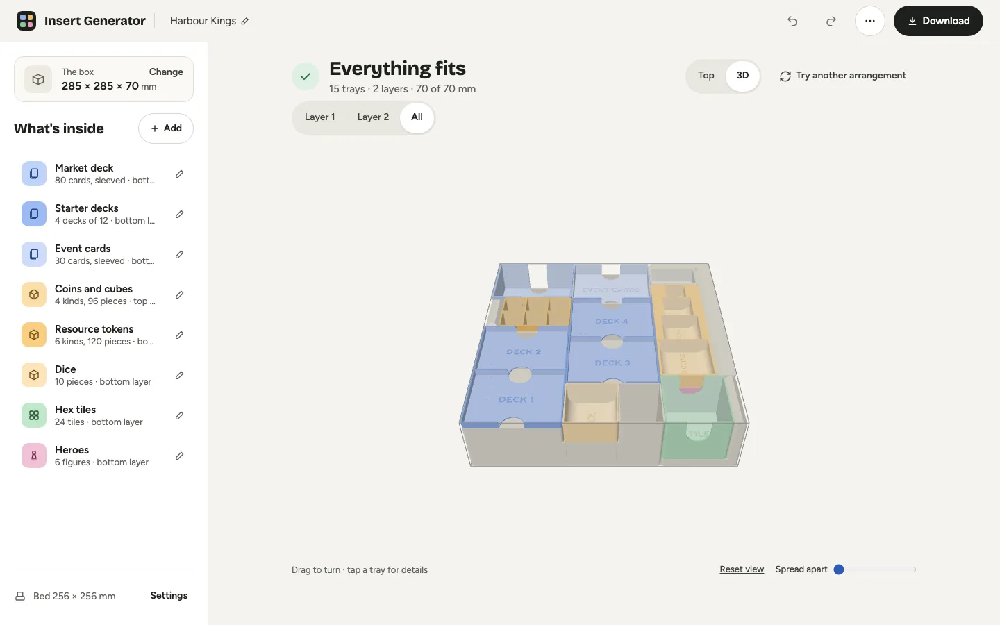
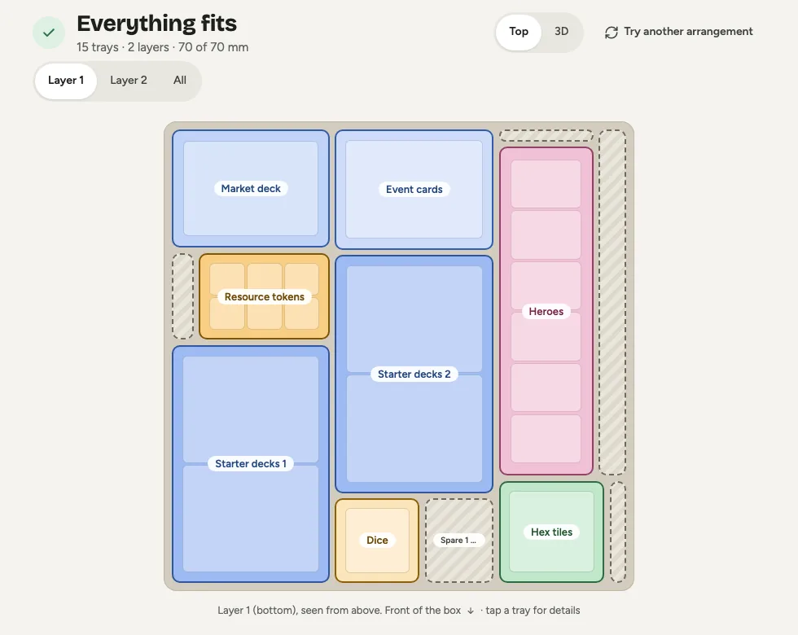
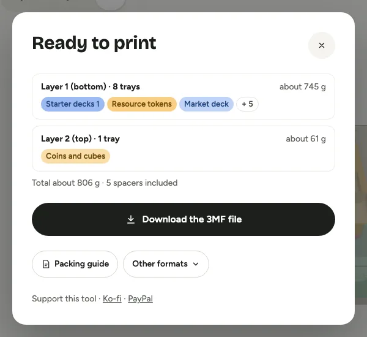
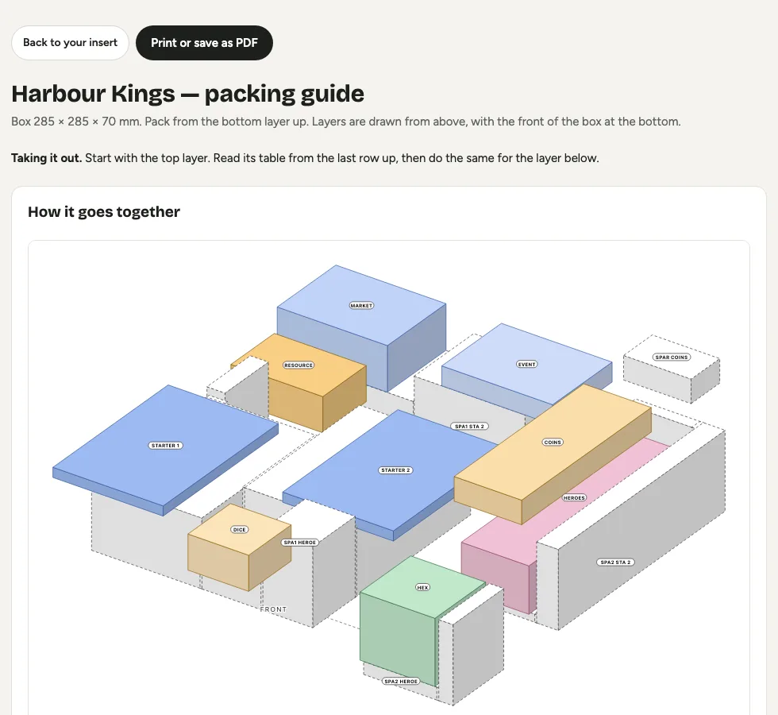

# Insert Generator

**Tell it what's in your game box. Get a box insert you can 3D print.**

### [Open Insert Generator](https://igorzamyslov.github.io/boardgame-insert-generator/)

Free, in your browser, nothing to install.

## How it works

1. **Describe your box and what's inside.** Type the inside size of the box, then add your
   cards, tokens and dice, tiles and miniatures. Or start from an example game.
2. **Get a plan that fits.** Trays are laid out in layers so everything has a place and the box
   closes. Look at it from above or turn it in 3D. Not happy? Try another arrangement.
3. **Download and print.** One file for your printer, plus a packing guide that shows what goes
   where and in which order.

| The plan                                                     | Ready to print                                                    | The packing guide                                                             |
| ------------------------------------------------------------ | ----------------------------------------------------------------- | ----------------------------------------------------------------------------- |
|  |  |  |

## What you get

- **Made for what you own.** Sleeved cards, tokens and dice, tiles and miniatures each get
  trays that suit them, with finger cuts to lift pieces out.
- **Groups that stay together.** Put a player's cards and tokens in one tray, and make as many
  copies as there are players.
- **Layers.** Trays stack with a lip that locates the one on top, so a deep box is used from
  bottom to lid.
- **Named trays.** Names can be engraved in each tray, and the packing guide tells you what to
  print and how to pack the box.
- **Sized for your printer.** Pick your print bed and every tray fits on it.
- **Stays on your computer.** There is no account. Your projects are saved in your browser, and a
  project file is how you back one up or send it to a friend.

## Support the project

Insert Generator is free. If it saved you an evening of measuring, you can say thanks:
[Ko-fi](https://ko-fi.com/igorzamyslov) or [PayPal](https://paypal.me/igorzamyslov).

## Feedback

Found a bug, or want a kind of tray that is missing?
[Tell us on GitHub](https://github.com/igorzamyslov/boardgame-insert-generator/issues).

## For developers

Vite, TypeScript and Preact; the layout search and the geometry run in Web Workers. Start with
[`docs/DEVELOPMENT.md`](docs/DEVELOPMENT.md) (guidelines, architecture, versioning, releasing),
[`docs/DESIGN.md`](docs/DESIGN.md) (design rules) and [`CHANGELOG.md`](CHANGELOG.md).
